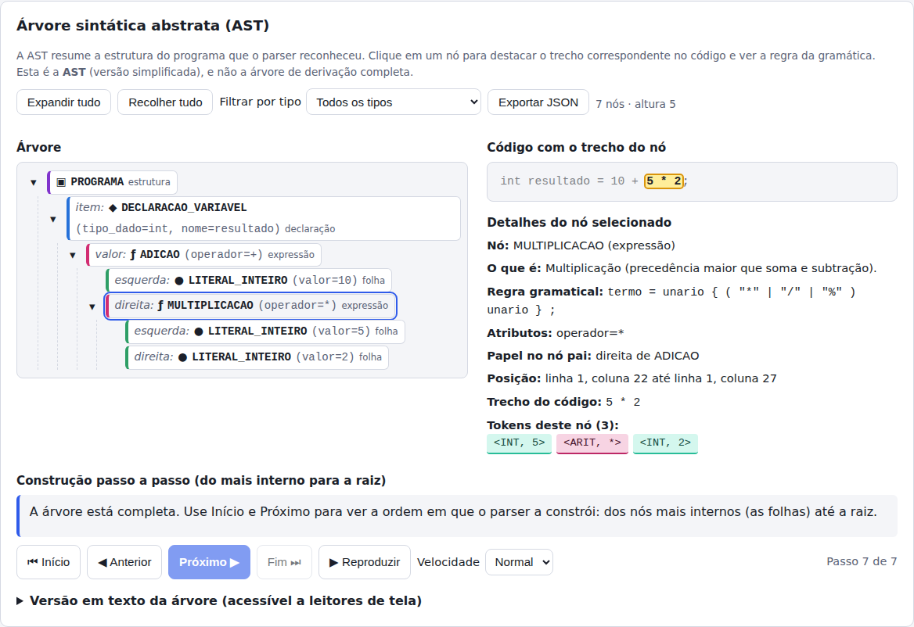
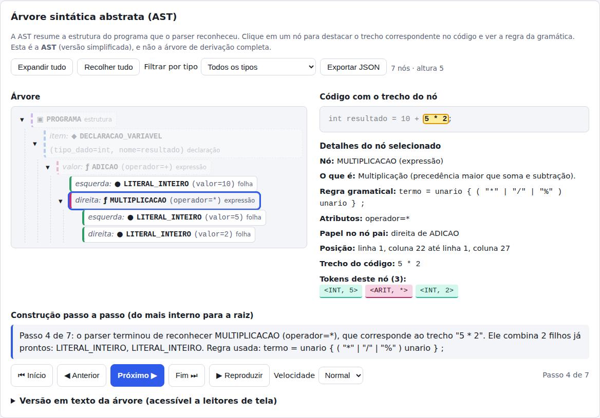
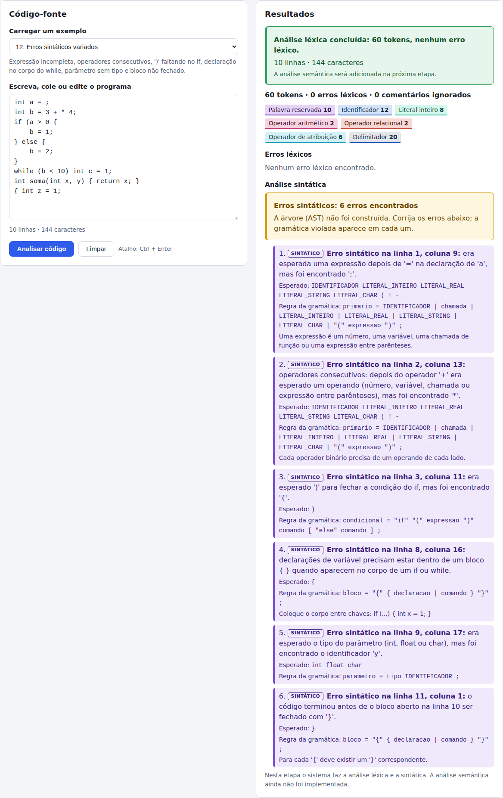
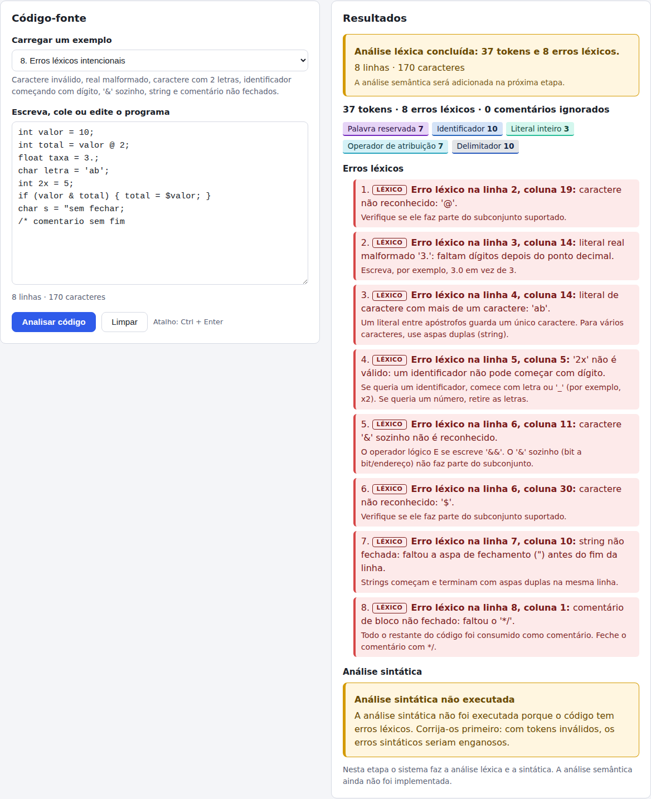
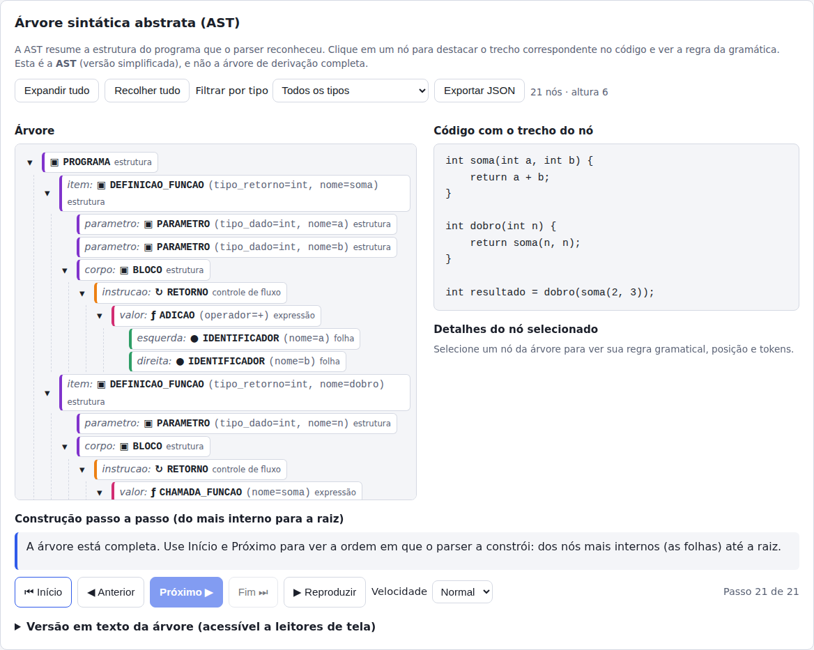
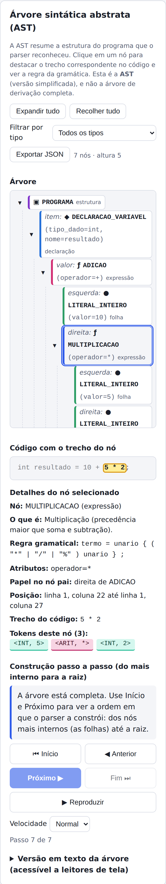

# Analisador Educacional de Compiladores

Software educacional para visualizar as fases de análise **léxica, sintática e semântica** de um programa. O usuário escreve (ou escolhe) um código em C e vê como o compilador o "enxerga".

> **Estado atual (Etapa 4):** análise léxica (scanner) e **análise sintática (parser) com construção da AST**, integradas à interface, com testes automatizados. **A análise semântica (Etapa 5) ainda NÃO está implementada**: o sistema aceita, por exemplo, uma variável não declarada. O diferencial opcional com Ollama/Llama 3.2 **não** foi implementado nesta versão.

## 1. Objetivo, linguagem e escopo

**Linguagem analisada: C** (um subconjunto).

- **Escopo léxico** (tokens, regras e erros): [`docs/escopo-lexico.md`](docs/escopo-lexico.md)
- **Gramática (EBNF), precedência e construções suportadas e fora do escopo:** [`docs/gramatica.md`](docs/gramatica.md)
- **Parser e AST** (estratégia, formato dos nós, contrato, erros): [`docs/parser.md`](docs/parser.md)

Resumo do que a gramática cobre: declarações com valor inicial opcional, atribuições, expressões aritméticas, relacionais e lógicas (com a precedência correta), `if`/`else`, `while`, blocos, `return`, **definição de funções com parâmetros** e **chamadas**. Fora do escopo: arrays, ponteiros, `for`, protótipos, pré-processador, expressões soltas como instrução.

```ebnf
programa      = { definicao_funcao | declaracao | comando } ;
declaracao    = tipo IDENTIFICADOR [ "=" expressao ] ";" ;
condicional   = "if" "(" expressao ")" comando [ "else" comando ] ;
soma          = termo { ( "+" | "-" ) termo } ;
termo         = unario { ( "*" | "/" | "%" ) unario } ;
(* ... gramática completa em docs/gramatica.md e no tutorial da interface *)
```

### O que a ferramenta faz de diferente

Entre as dez fontes comparadas no artigo (Tarefas 1 a 4), nenhuma analisa um subconjunto declarado da própria linguagem **C**, e nenhuma descreve o formato das mensagens de erro nem avalia sua eficácia. Recursos isolados, como a construção passo a passo da árvore, já existem na literatura; o que esta ferramenta reúne em um só lugar é:

- **Scanner passo a passo**, caractere a caractere, com os estados do autômato;
- **Árvore sintática (AST) navegável**: clique em um nó e o trecho do código é destacado, com a regra gramatical, a posição e os tokens daquele nó (relaciona árvore, código, regra e tabela de tokens);
- **Construção da árvore animada**, do mais interno para a raiz, com avançar, voltar e reproduzir;
- **Erros léxicos e sintáticos acumulados**, visualmente distintos, com mensagem didática, o que era esperado, a **regra da gramática violada** e dica de correção;
- **Gramática publicada** na interface e na documentação, **tutorial integrado**, exportação da AST em JSON e versão em texto acessível;
- **Layout responsivo** (testado em emulação de celular).

> Isto descreve o que está implementado e verificável. Não se alega ineditismo: o diferencial pretendido e a comparação com a literatura estão em `docs/materiais-e-metodos.md` e no artigo.

## 2. Tecnologias

| Camada | Tecnologia |
|---|---|
| Frontend | HTML, CSS e JavaScript puros, servidos pelo Nginx 1.27 |
| Backend | Python 3.12 + FastAPI (Uvicorn). **Scanner e parser escritos à mão**, sem dependências novas |
| Orquestração | Docker Compose (a Etapa 4 **não** adicionou serviços, portas nem dependências) |
| Testes | pytest (backend), `node:test` + jsdom (interface), Playwright (ponta a ponta), scripts shell (API e implantação) |

## 3. Estrutura do repositório

```
.
├── backend/
│   ├── app/
│   │   ├── main.py          # rotas e tratamento de erros
│   │   ├── scanner.py       # analisador léxico (Etapa 3)
│   │   ├── parser.py        # analisador sintático e AST (Etapa 4)
│   │   ├── gramatica.py     # gramática EBNF e metadados dos nós
│   │   ├── analise.py       # integra scanner + parser na resposta
│   │   ├── validacao.py     # validações de entrada (Etapa 2)
│   │   └── exemplos.py      # programas de exemplo
│   ├── tests/               # scanner, parser, gramática, API, validação, fixtures
│   └── Dockerfile
├── frontend/
│   ├── index.html, style.css
│   ├── app.js               # validação local, cliente HTTP e interação
│   ├── visual.js            # tabela de tokens, cores, passo a passo do scanner
│   ├── arvore.js            # erros sintáticos, AST navegável e construção animada
│   ├── nginx.conf
│   ├── tests/               # interface (jsdom), integração e fixtures reais do backend
│   └── Dockerfile
├── tests/e2e/               # testes de ponta a ponta (Playwright)
├── scripts/                 # verificar_api.sh, testar_implantacao.sh, gerar_fixtures.py, capturar_prints.py, gerar_fluxograma.py, gerar_casos.py
├── docs/                    # escopo-lexico, gramatica, scanner, parser, fluxograma, materiais-e-metodos, casos-de-teste,
│                            # testes, prints, avaliacao/ (formulário) e diagramas/ (Graphviz)
├── config/.env.example
├── docker-compose.yml
└── README.md
```

## 4. Pré-requisitos

- Docker 24+ e Docker Compose v2+ (`docker compose`)
- Git
- Só para rodar os testes fora do Docker: Python 3.12+ e Node.js 20+ (testado com 22)

## 5. Como executar

```bash
git clone https://github.com/felipemoraesm/analisador-educacional.git
cd analisador-educacional
docker compose up --build
```

Acesse **http://localhost:8080**. Para rodar em segundo plano use `-d`. Para trocar a porta: `cp config/.env.example .env` e edite `FRONTEND_PORT`.

Para encerrar: `docker compose down`.

Se aparecer erro de nome de contêiner já em uso (execução anterior em outra pasta): `docker rm -f analisador-backend analisador-frontend`. Não há senhas nem credenciais no repositório.

## 6. Como usar a interface

1. Abra o **Tutorial** (o que é scanner, token, parser, AST, a gramática e a precedência).
2. Escolha um exemplo ou escreva/cole o seu código e clique em **Analisar código** (ou `Ctrl + Enter`).
3. **Resultados:** análise léxica (resumo e erros léxicos) e **análise sintática** (verde se válida; amarela com a lista de erros sintáticos).
4. Abaixo: **passo a passo do scanner**, **código colorido**, **árvore sintática (AST)** e **tabela de tokens**.
5. Na AST: clique em um nó; use *Expandir/Recolher tudo*, o filtro por tipo, *Exportar JSON* e os controles da **construção passo a passo**.
6. Com **erro léxico**, o parser **não roda** (a interface explica o motivo); com **erro sintático**, a AST não é construída e o trecho problemático é marcado no código.

## 7. Exemplos disponíveis

| # | Exemplo | O que demonstra |
|---|---|---|
| 1 | Declaração e inicialização | `int`, atribuição |
| 2 | Operações aritméticas | `+ - * /` e parênteses |
| 3 | Estrutura condicional (if) | `if`, `>`, bloco |
| 4 | if/else com comentário | `else`, `==`, comentário ignorado |
| 5 | Erros sintáticos (tokens válidos) | falta `;` e expressão incompleta: o scanner tokeniza, o parser aponta 2 erros |
| 6 | Tipos e literais | `float`, `char`, real, caractere, string |
| 7 | Operadores, delimitadores e while | maior casamento (`<=`, `&&`...), `while`, `return` |
| 8 | Erros léxicos intencionais | 8 erros léxicos; o **parser não roda** |
| 9 | Precedência e associatividade | `10 + 5 * 2`, `20 - 5 - 3`, `(10 + 5) * 2` |
| 10 | Funções e chamadas | definição com parâmetros, `return`, chamadas aninhadas |
| 11 | while com if/else aninhados | blocos dentro de blocos |
| 12 | Erros sintáticos variados | 6 erros de uma vez (sem cascata) |

Os exemplos ficam em `backend/app/exemplos.py` e são servidos por `GET /api/exemplos`.

## 8. Contrato da API

Detalhes completos em [`docs/parser.md`](docs/parser.md) (e `docs/scanner.md` para os campos léxicos).

`POST /api/analisar` com `{"codigo": "int resultado = 10 + 5 * 2;"}` devolve **HTTP 200** (inclusive com erros léxicos ou sintáticos):

```json
{
  "recebido": true, "sucesso": true, "mensagem": "Análise léxica concluída: 9 tokens, nenhum erro léxico.",
  "linhas": 1, "caracteres": 27,
  "tokens": [ "..." ], "erros": [], "comentarios": [], "resumo": { "...": "..." },
  "lexico":   { "sucesso": true, "tokens": [ "..." ], "erros": [], "comentarios": [], "resumo": { "...": "..." } },
  "sintatico": {
    "executado": true, "sucesso": true,
    "mensagem": "Análise sintática concluída: programa válido (AST com 7 nós).",
    "ast": { "tipo": "PROGRAMA", "filhos": [ "..." ] },
    "erros": [], "resumo": { "total_nos": 7, "altura": 5, "por_tipo": { "...": 0 } },
    "regras": { "ADICAO": { "regra": "soma = ...", "descricao": "...", "categoria": "expressao" } },
    "texto": "PROGRAMA  [1:1]\n└── ..."
  }
}
```

Os campos da **Etapa 3 foram preservados** no nível superior; `lexico` e `sintatico` são acréscimos. Com erro sintático (`int numero = 10}`), `sintatico.sucesso` é `false`, `ast` é `null` e `erros` traz:

```json
{ "tipo": "ERRO_SINTATICO", "linha": 1, "coluna": 16, "encontrado": "}", "esperado": [";"],
  "mensagem": "Era esperado ';' ao final da declaração, mas foi encontrado '}'.",
  "regra": "declaracao = tipo IDENTIFICADOR [ \"=\" expressao ] \";\" ;" }
```

Com **erro léxico**, o parser não é executado: `sintatico.executado = false`, `sintatico.sucesso = null` e `sintatico.motivo` explica.

| Situação | HTTP |
|---|---|
| Análise concluída (com ou sem erros) | 200 |
| Código vazio / só espaços / corpo inválido / Unicode inválido | 400 |
| Acima de 20.000 caracteres | 413 |
| Erro inesperado | 500 (mensagem genérica) |

Outros endpoints: `GET /api/gramatica` (EBNF, precedência e metadados), `GET /api/exemplos`, `GET /api/health` e `GET /api/hello` (Etapa 1, mantido como regressão).

### Decisão sobre erros léxicos

**O parser não é executado quando há erro léxico**: tokens com lacunas produziriam erros sintáticos enganosos, em cascata. Os erros léxicos continuam sendo exibidos e a interface explica o motivo. Testado no backend, na interface e de ponta a ponta.

### Recuperação de erros sintáticos

Modo pânico (sincroniza em `;`, `}` ou início de instrução), até **10 erros** por análise, com regras contra erros em cascata (`;` esquecido, `else` órfão, palavra reservada ofensora, fim de código reportado uma vez). Limites: 40 níveis de aninhamento e altura 120 da árvore.

## 9. Testes automatizados

| Tipo | Local | Comando |
|---|---|---|
| Scanner, parser, gramática, endpoints e casos do artigo | `backend/tests/` | `cd backend && pip install -r requirements-dev.txt && pytest` |
| Interface (jsdom) | `frontend/tests/` | `cd frontend && npm install && npm test` |
| Integração frontend ↔ backend real | `frontend/tests/integracao.test.js` | `API_URL=http://localhost:8080 npm run test:integracao` |
| Ponta a ponta (navegador) | `tests/e2e/` | `pip install -r tests/e2e/requirements.txt && playwright install chromium && pytest tests/e2e -v` |
| Verificação HTTP | `scripts/verificar_api.sh` | `bash scripts/verificar_api.sh http://localhost:8080` |
| Implantação (Docker Compose) | `scripts/testar_implantacao.sh` | `bash scripts/testar_implantacao.sh` |

Integração, ponta a ponta e implantação exigem a aplicação no ar (`docker compose up --build -d`). No Windows, use o **Git Bash** para os scripts `.sh`. As fixtures do frontend são respostas **reais** do backend (`cd backend && python ../scripts/gerar_fixtures.py`); `test_fixtures.py` falha se ficarem desatualizadas. Também há testes que mantêm sincronizados o código da gramática e `docs/gramatica.md`.

**Regressão:** todos os testes das Etapas 1 a 3 continuam no conjunto. Os poucos testes antigos alterados de propósito estão listados em [`docs/testes.md`](docs/testes.md).

### Resultados

Registro completo (comandos, falhas encontradas e corrigidas, mudanças intencionais) em [`docs/testes.md`](docs/testes.md).

| Suíte | Resultado |
|---|---|
| Scanner (unitários) | 159 aprovados |
| Parser (unitários, aleatórios e de robustez) | 114 aprovados |
| Casos de teste do artigo (`test_casos_artigo.py`, 13/11/2026) | 68 aprovados, 7 ignorados (Etapa 5) |
| Backend (total, com gramática, endpoints, fixtures e casos do artigo) | 415 aprovados, 7 ignorados |
| Interface – Etapa 2, Etapa 3 e Etapa 4 | 37 + 37 + 42 aprovados |
| Integração com backend real | 16 aprovados |
| Ponta a ponta (Chromium) | 41 aprovados |
| Verificação HTTP | 34/34 aprovadas |
| **Total** | **622 aprovados, 0 reprovados** (integração, E2E e HTTP da execução anterior) |
| Implantação com Docker Compose (24/11/2026) | **Aprovada**: imagens construídas, backend saudável e 34/34 verificações HTTP via Nginx nos contêineres |

Os números das suítes vieram de execuções com Uvicorn e Nginx (com a `nginx.conf` do projeto) **fora de contêineres**. A implantação foi verificada à parte, com Docker Compose, por `scripts/testar_implantacao.sh` (registro em [`docs/testes.md`](docs/testes.md)).

## 10. Prints da interface

| | |
|---|---|
|  |  |
|  |  |
|  |  |
|  |  |

<!-- Para adicionar seu print da execução com Docker: salve em docs/img/14-print-docker.png e troque esta linha por:
 -->

Fluxograma do sistema: [`docs/fluxograma.md`](docs/fluxograma.md) (versão simples e versão detalhada do artigo). Arquitetura: [`docs/img/arquitetura.png`](docs/img/arquitetura.png).

Documentação para o artigo (Tarefa 4): [`docs/materiais-e-metodos.md`](docs/materiais-e-metodos.md) (critérios C1–C18 e comparação com a literatura), [`docs/casos-de-teste.md`](docs/casos-de-teste.md) (78 casos), [`docs/avaliacao/formulario.md`](docs/avaliacao/formulario.md) (avaliação por pares) e [`docs/diagramas/`](docs/diagramas/) (fontes Graphviz).

## 11. Validação de instalação limpa

```bash
docker compose down --rmi local -v
docker builder prune -af
cd ..
rm -rf analisador-educacional
git clone https://github.com/felipemoraesm/analisador-educacional.git
cd analisador-educacional
bash scripts/testar_implantacao.sh
```

Registro:

- Data: 24/11/2026
- Sistema operacional: Windows 11
- Versões de Docker / Compose: Docker 29.8.2 / Docker Compose v5.6.0
- Comando: `bash scripts/testar_implantacao.sh` (Git Bash)
- Resultado: **Aprovado**. Imagens construídas, `analisador-backend` saudável, `analisador-frontend` iniciado e 34/34 verificações HTTP aprovadas.

## 12. Limitações conhecidas

- **Não há análise semântica** (Etapa 5): variável não declarada, tipos incompatíveis e `return` fora de função são aceitos.
- Gramática de um **subconjunto** de C (ver `docs/gramatica.md`); recuperação de erros heurística.
- **Ainda não houve avaliação com estudantes** (planejada: `docs/avaliacao/formulario.md`): os testes verificam correção técnica, não eficácia pedagógica.
- Erros no início de uma instrução (`10 = x;`, `;` sozinho) não informam a regra violada (`regra = null`).
- O celular foi **emulado**, não testado em aparelho real; os testes de navegador cobrem só Chromium.
- Código limitado a 20.000 caracteres; a tabela mostra até 2.000 tokens; a versão em texto da árvore só existe para árvores de até 1.000 nós (há aviso na tela).
- Identificadores aceitam só letras ASCII; não há banco de dados nem persistência.
- **Diferencial opcional (Ollama + Llama 3.2) não implementado.**

## 13. Próximas etapas

Etapa 5: análise semântica sobre a AST (declaração antes do uso, tipos), usando a posição registrada em cada nó.
