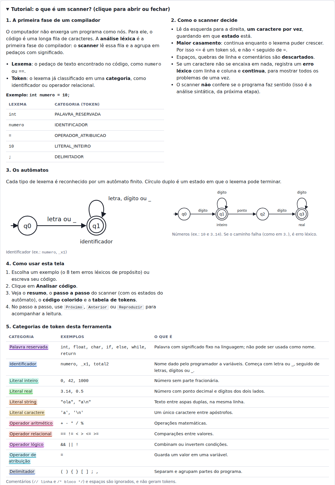
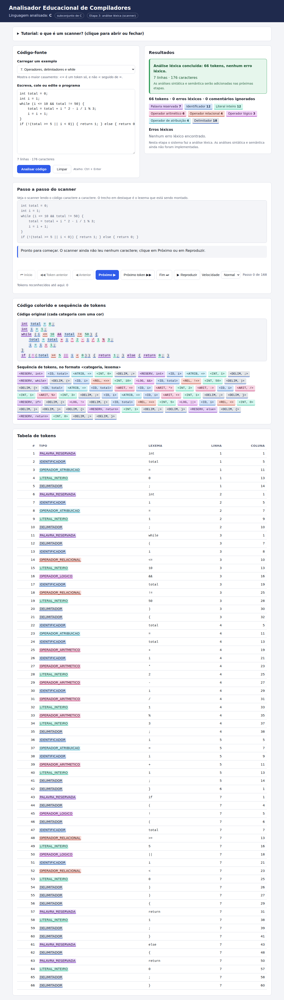
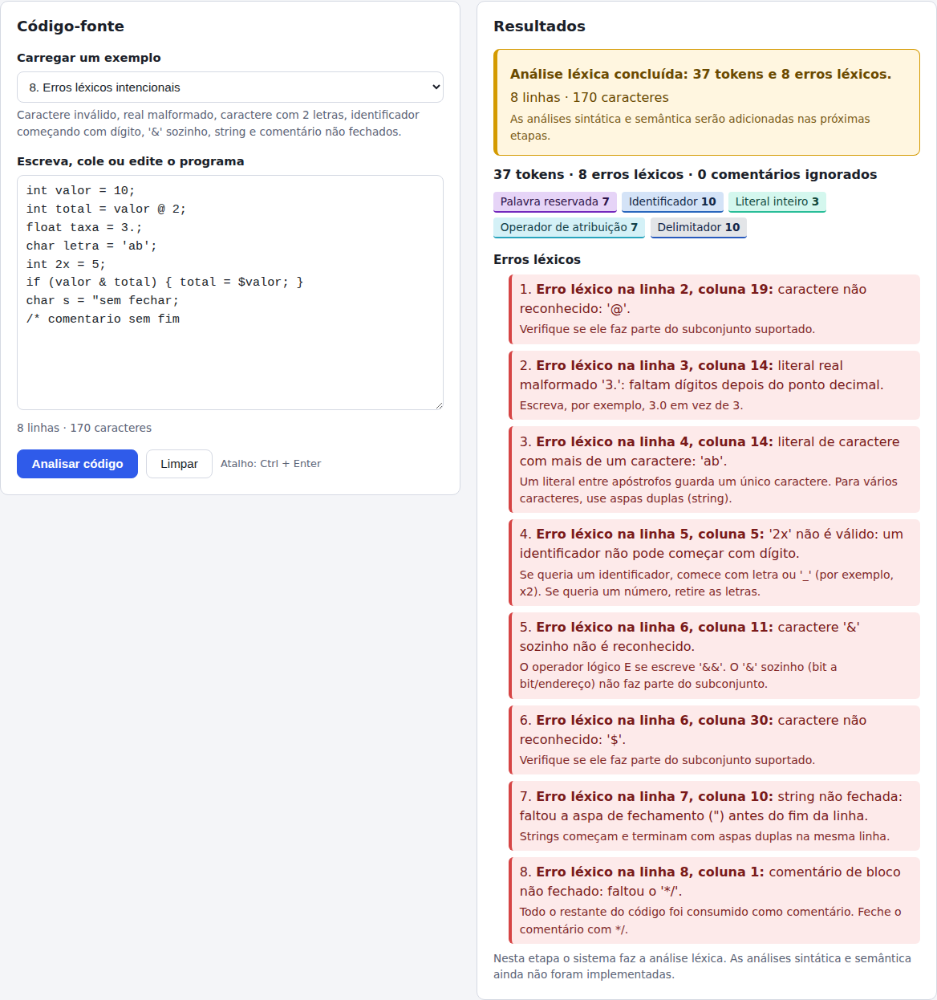
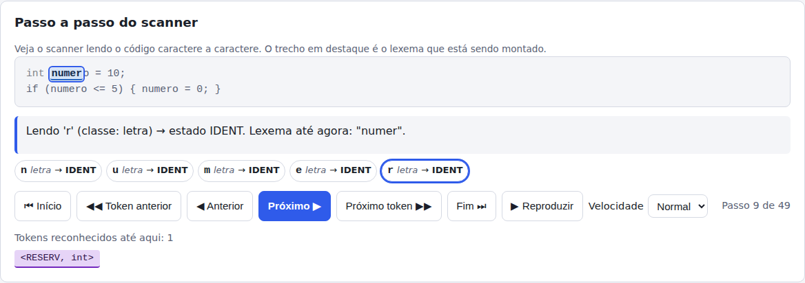
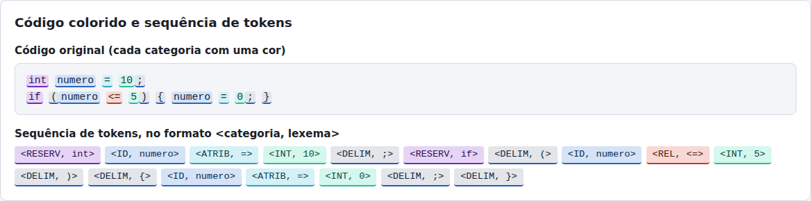
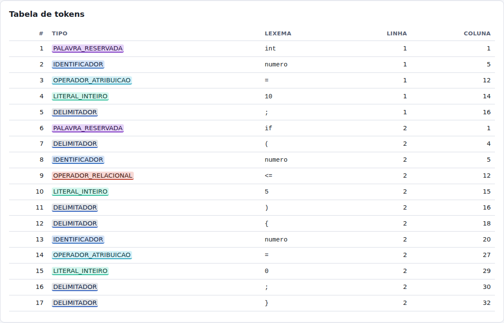
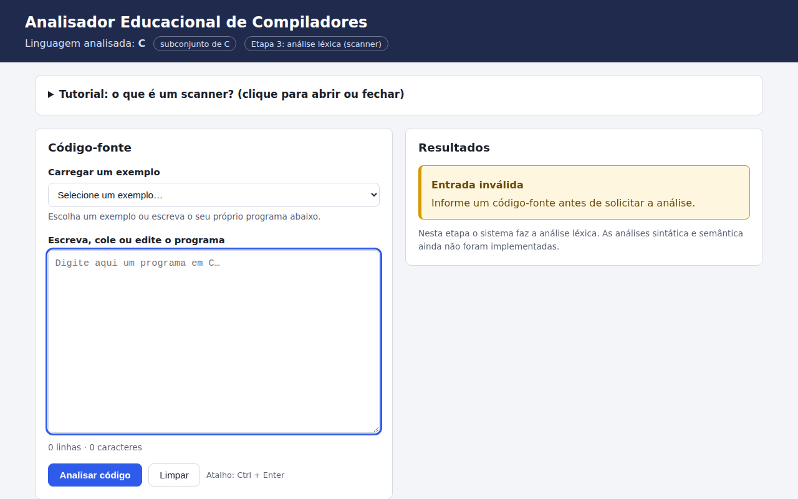
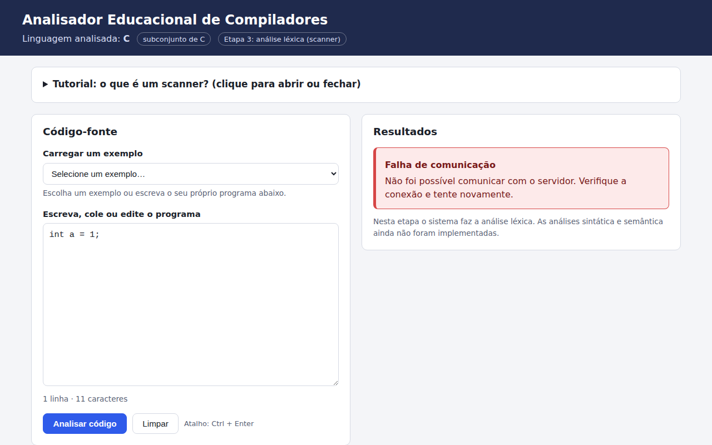
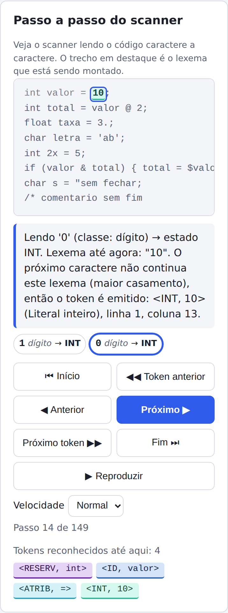

# Analisador Educacional de Compiladores

Software educacional para visualizar as fases de análise **léxica, sintática e semântica** de um programa. O usuário escreve (ou escolhe) um código-fonte em C e vê como o compilador o "enxerga".

> **Estado atual (Etapa 3):** análise léxica (scanner) implementada e integrada à interface: tokens, erros léxicos, passo a passo animado, tutorial e testes automatizados. **As análises sintática (Etapa 4) e semântica (Etapa 5) ainda NÃO estão implementadas.** Um programa com erros sintáticos, mas com tokens válidos, é tokenizado normalmente.

## 1. Objetivo, linguagem e escopo

**Linguagem analisada: C** (um subconjunto). O escopo léxico completo, com regras de formação, exemplos e tratamento de erros, está em [`docs/escopo-lexico.md`](docs/escopo-lexico.md). Resumo:

| Categoria | Exemplos |
|---|---|
| Palavras reservadas | `int` `float` `char` `if` `else` `while` `return` |
| Identificadores | `numero`, `_x1` (letra ou `_`, seguida de letras, dígitos ou `_`) |
| Literais | inteiros `10`; reais `3.14`; strings `"ola\n"`; caracteres `'a'`, `'\n'` |
| Operadores | aritméticos `+ - * / %`; relacionais `== != < > <= >=`; lógicos `&& \|\| !`; atribuição `=` |
| Delimitadores | `( ) { } [ ] ; ,` |
| Comentários | `// linha` e `/* bloco */` (ignorados) |
| Espaços e quebras de linha | ignorados |
| Caracteres não reconhecidos | geram **erro léxico** com linha, coluna e dica; a leitura continua |

Fora do escopo por enquanto: pré-processador (`#include`), `for`, `void`, ponteiros, `++`/`--`, hexadecimal e notação científica.

### Por que C e o que a ferramenta faz de diferente

Entre os três artigos fichados na Tarefa 1, nenhum usa **C** como linguagem analisada (Portugol, *parsers* gerados com CUP/Java e DSLs em Python). Além disso, esta ferramenta reúne em um só lugar recursos que aparecem separados nesses trabalhos:

- **Passo a passo caractere a caractere**, com o estado do autômato a cada leitura (ideia do autômato animado e dos botões de avançar/voltar do Artigo 1);
- **Controles de reprodução, retrocesso e salto** por token (ideia do ParVis, Artigo 2) e velocidade ajustável;
- **Tabela de tokens e diagramas de autômato** (como no Artigo 3), mais **código colorido** por categoria e **sequência de tokens** `<categoria, lexema>` para comparar com o código original;
- **Erros léxicos acumulados** com mensagem didática e dica de correção (por exemplo, `&` sozinho sugere `&&`);
- **Tutorial integrado** à tela e documentação do escopo léxico, do scanner e do contrato da API;
- **Layout responsivo**, utilizável no celular (testado em emulação).

## 2. Tecnologias

| Camada | Tecnologia |
|---|---|
| Frontend | HTML, CSS e JavaScript puro, servidos pelo Nginx 1.27 |
| Backend | Python 3.12 + FastAPI (Uvicorn). **Scanner escrito à mão em Python puro**, sem dependências novas (justificativa em [`docs/scanner.md`](docs/scanner.md)) |
| Orquestração | Docker Compose |
| Testes | pytest (backend), `node:test` + jsdom (interface), Playwright (ponta a ponta), scripts shell (API e implantação) |

## 3. Estrutura do repositório

```
.
├── backend/
│   ├── app/
│   │   ├── main.py          # rotas e tratamento de erros
│   │   ├── scanner.py       # analisador léxico (Etapa 3)
│   │   ├── validacao.py     # validações de entrada (Etapa 2)
│   │   └── exemplos.py      # programas de exemplo
│   ├── tests/               # test_scanner.py, test_api.py, test_validacao.py, test_fixtures.py
│   └── Dockerfile
├── frontend/
│   ├── index.html           # tela, tutorial e painéis
│   ├── style.css
│   ├── app.js               # validação local, cliente HTTP e interação
│   ├── visual.js            # tabela, cores, erros e passo a passo
│   ├── nginx.conf           # serve a página e repassa /api/ ao backend
│   ├── tests/               # interface (jsdom), integração e fixtures reais do backend
│   └── Dockerfile
├── tests/e2e/               # testes de ponta a ponta com navegador (Playwright)
├── scripts/                 # verificar_api.sh, testar_implantacao.sh, gerar_fixtures.py, capturar_prints.py
├── docs/                    # escopo-lexico.md, scanner.md, testes.md e prints
├── config/.env.example
├── docker-compose.yml
└── README.md
```

## 4. Pré-requisitos

- Docker 24+ e Docker Compose v2+ (`docker compose`)
- Git
- Só para rodar os testes fora do Docker: Python 3.12+ e Node.js 20+ (testado com 22)

## 5. Como executar

```bash
git clone https://github.com/felipemoraesm/analisador-educacional.git
cd analisador-educacional
docker compose up --build
```

Acesse **http://localhost:8080**. Para rodar em segundo plano use `-d`. Para trocar a porta: `cp config/.env.example .env` e edite `FRONTEND_PORT`.

Para encerrar:

```bash
docker compose down
```

Se aparecer erro de nome de contêiner já em uso (de uma execução anterior em outra pasta): `docker rm -f analisador-backend analisador-frontend`. Não há senhas nem credenciais no repositório; a única variável opcional é `FRONTEND_PORT`. A Etapa 3 **não adicionou dependências nem portas**.

## 6. Como usar a interface

1. Abra o **Tutorial** no topo (o que é scanner, token, lexema, autômatos e como usar a tela).
2. Escolha um exemplo ou escreva/cole o seu código, e clique em **Analisar código** (ou `Ctrl + Enter`).
3. Em **Resultados**: mensagem da análise (verde sem erros léxicos, amarelo com erros), contagem por categoria e **lista de erros léxicos** com linha, coluna e dica.
4. Abaixo aparecem:
   - **Passo a passo do scanner**: Próximo/Anterior, Próximo token/Token anterior, Início/Fim e Reproduzir com velocidade. Mostra o lexema em montagem, o estado do autômato a cada caractere e os tokens reconhecidos até ali;
   - **Código colorido** (comentários em cinza, erros sublinhados) e **sequência de tokens** `<categoria, lexema>`;
   - **Tabela de tokens** (tipo, lexema, linha, coluna).
5. **Limpar** apaga o código, o exemplo e os resultados.

## 7. Exemplos disponíveis

| # | Exemplo | O que demonstra |
|---|---|---|
| 1 | Declaração e inicialização | `int`, identificadores, `=`, inteiros, `;` |
| 2 | Operações aritméticas | `+ - * /`, parênteses |
| 3 | Estrutura condicional (if) | `if`, `>`, chaves |
| 4 | if/else com comentário | `else`, `==`, comentário `//` (ignorado) |
| 5 | Erros sintáticos/semânticos (tokens válidos) | falta `;`, expressão incompleta, variável não declarada: **o scanner tokeniza normalmente** |
| 6 | Tipos e literais | `float`, `char`, real `1.75`, caractere `'A'`, escape `'\n'`, string `"Ola, mundo!\n"` |
| 7 | Operadores, delimitadores e while | maior casamento (`<=`, `!=`, `&&`, `\|\|`, `!`), `%`, `while`, `return` |
| 8 | Erros léxicos intencionais | `@`, `$`, `&` sozinho, `3.`, `'ab'`, `2x`, string e comentário não fechados (8 erros de uma vez) |

Os exemplos ficam em `backend/app/exemplos.py` e são servidos por `GET /api/exemplos`.

## 8. Contrato de comunicação (API)

O navegador chama `/api/...` no Nginx, que repassa a `backend:8000`. Detalhes completos, com todos os campos, em [`docs/scanner.md`](docs/scanner.md).

### `POST /api/analisar`

Requisição: `{"codigo": "int numero = 10;"}`

Resposta (HTTP 200, **inclusive com erros léxicos**: a análise foi feita e os erros são parte do resultado):

```json
{
  "recebido": true,
  "sucesso": true,
  "mensagem": "Análise léxica concluída: 5 tokens, nenhum erro léxico.",
  "linhas": 1, "caracteres": 16,
  "tokens": [
    { "tipo": "PALAVRA_RESERVADA", "lexema": "int", "linha": 1, "coluna": 1,
      "inicio": 0, "fim": 3,
      "caminho": [ { "c": "i", "classe": "letra", "estado": "IDENT" } ] }
  ],
  "erros": [],
  "comentarios": [],
  "resumo": { "total_tokens": 5, "total_erros": 0, "total_comentarios": 0,
              "por_categoria": { "PALAVRA_RESERVADA": 1, "IDENTIFICADOR": 1,
                                 "LITERAL_INTEIRO": 1, "OPERADOR_ATRIBUICAO": 1, "DELIMITADOR": 1 } }
}
```

(`tokens` abreviado.) Com erro léxico, `sucesso` é `false` e `erros` traz objetos como:

```json
{ "tipo": "ERRO_LEXICO", "lexema": "@", "linha": 2, "coluna": 10,
  "mensagem": "Caractere não reconhecido: '@'",
  "dica": "Verifique se ele faz parte do subconjunto suportado." }
```

| Situação | HTTP | Corpo |
|---|---|---|
| Análise concluída (com ou sem erros léxicos) | 200 | contrato acima |
| Código vazio | 400 | `{"recebido": false, "erro": "codigo_vazio", "mensagem": "Informe um código-fonte antes de solicitar a análise."}` |
| Somente espaços | 400 | `{"recebido": false, "erro": "codigo_somente_espacos", ...}` |
| Corpo ausente, JSON malformado, campo faltando ou de tipo errado | 400 | `{"recebido": false, "erro": "requisicao_invalida", ...}` |
| Acima de 20.000 caracteres | 413 | `{"recebido": false, "erro": "codigo_muito_grande", ...}` |
| Erro inesperado | 500 | mensagem genérica; detalhes só no log do servidor |

Outros endpoints: `GET /api/exemplos`, `GET /api/health` e `GET /api/hello` (Etapa 1, mantido como teste de regressão).

**Mudança em relação à Etapa 2:** a `mensagem` de sucesso passou a descrever a análise léxica (antes: "Código recebido com sucesso."). Os campos `recebido`, `linhas` e `caracteres` foram mantidos.

### Exemplos de entrada e saída do scanner

| Entrada | Saída (lexema → categoria) |
|---|---|
| `a<=b` | `a` ID · `<=` OPERADOR_RELACIONAL · `b` ID |
| `x = 3.14;` | `x` ID · `=` ATRIBUICAO · `3.14` LITERAL_REAL · `;` DELIMITADOR |
| `// c` + `int a;` | comentário ignorado; `int` `a` `;` |
| `int a = @;` | `int` `a` `=` `;` e **erro** `@` (linha 1, coluna 9) |
| `3.` | **erro**: literal real malformado (faltam dígitos depois do ponto) |

## 9. Testes automatizados

| Tipo | Local | Comando |
|---|---|---|
| Unitários do scanner e endpoints | `backend/tests/` | `cd backend && pip install -r requirements-dev.txt && pytest` |
| Interface (jsdom) | `frontend/tests/` | `cd frontend && npm install && npm test` |
| Integração frontend↔backend real | `frontend/tests/integracao.test.js` | `API_URL=http://localhost:8080 npm run test:integracao` |
| Ponta a ponta (navegador) | `tests/e2e/` | `pip install -r tests/e2e/requirements.txt && playwright install chromium && pytest tests/e2e -v` |
| Verificação HTTP da API | `scripts/verificar_api.sh` | `bash scripts/verificar_api.sh http://localhost:8080` |
| Implantação (Docker Compose) | `scripts/testar_implantacao.sh` | `bash scripts/testar_implantacao.sh` (opcional: `RODAR_E2E=1`) |

Os testes de integração, de ponta a ponta e de implantação precisam da aplicação em execução (`docker compose up --build -d`). No Windows, use o **Git Bash** para os scripts `.sh`.

As fixtures do frontend (`frontend/tests/fixtures/`) são respostas **reais** do backend; o teste `backend/tests/test_fixtures.py` falha se elas ficarem desatualizadas (regenerar com `cd backend && python ../scripts/gerar_fixtures.py`).

**Regressão:** os testes das Etapas 1 e 2 (`/api/hello`, `/api/health`, validações, exemplos, edição, falhas de comunicação) continuam no conjunto e são executados junto.

### Resultados

Registro completo (comandos, falhas encontradas e correções, mudanças intencionais) em [`docs/testes.md`](docs/testes.md).

| Suíte | Resultado |
|---|---|
| Scanner (unitários) | 154 aprovados, 0 reprovados |
| Backend (total, com endpoints e fixtures) | 202 aprovados, 0 reprovados |
| Interface – Etapa 2 (regressão) | 37 aprovados, 0 reprovados |
| Interface – Etapa 3 | 37 aprovados, 0 reprovados |
| Integração com backend real | 10 aprovados, 0 reprovados |
| Ponta a ponta (Chromium) | 25 aprovados, 0 reprovados |
| Verificação HTTP da API | 23/23 aprovadas |
| Implantação com Docker Compose | Aprovada: serviços iniciaram, backend saudável e 23/23 verificações da API |

Os números acima foram obtidos com Uvicorn e Nginx (com a `nginx.conf` do projeto) **fora de contêineres**.

## 10. Prints da interface

| | |
|---|---|
|  |  |
|  |  |
|  |  |
|  |  |
|  |  |

<!-- Para adicionar seu print da execução com Docker: salve em docs/img/12-print-docker.png e troque esta linha por:
 -->

## 11. Validação de instalação limpa

```bash
docker compose down --rmi local -v
docker builder prune -af
cd ..
rm -rf analisador-educacional
git clone https://github.com/felipemoraesm/analisador-educacional.git
cd analisador-educacional
bash scripts/testar_implantacao.sh
```

Registro (preencher):

- Data: 29/10/2026
- Sistema operacional: Windows 11
- Versões de Docker / Compose: 29.8.2
- Resultado: Aprovado

## 12. Limitações conhecidas

- **Não há análise sintática nem semântica** (Etapas 4 e 5). O scanner só reconhece tokens: um `if (x ;` gera tokens válidos.
- Escopo léxico limitado ao subconjunto documentado (sem pré-processador, `for`, `void`, ponteiros, hexadecimal ou notação científica).
- Identificadores aceitam só letras ASCII; letra acentuada fora de string ou comentário é erro léxico.
- Código limitado a 20.000 caracteres; a tabela exibe até 2.000 tokens e a sequência até 400 (há aviso na tela).
- Os testes de interface usam jsdom (sem CSS); os de navegador cobrem só Chromium, e o **celular é emulado**, não testado em aparelho real.
- O seletor de exemplos só recarrega um exemplo quando outro é escolhido.
- Não há banco de dados nem persistência: o código vive só na página aberta.

## 13. Próximas etapas

Etapa 4: análise sintática (parser) consumindo a lista de tokens do scanner. Etapa 5: análise semântica (declaração antes do uso, tipos). O endpoint `POST /api/analisar` é o ponto onde elas serão acopladas.
