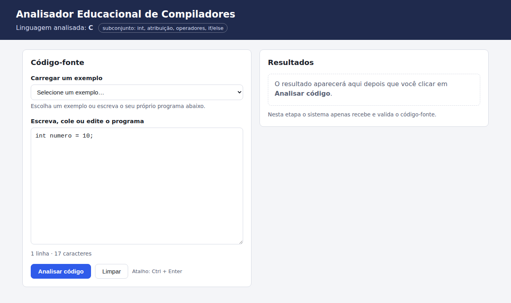
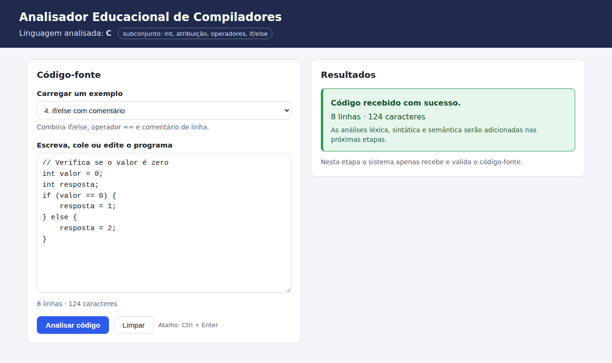
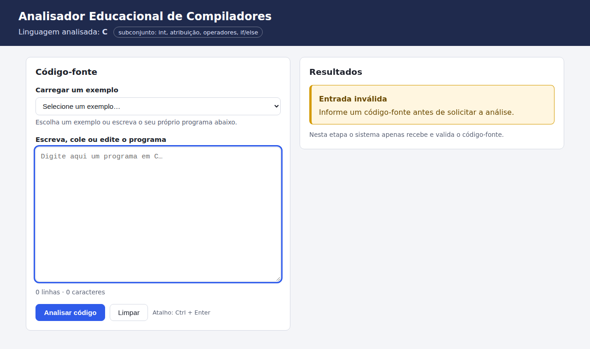
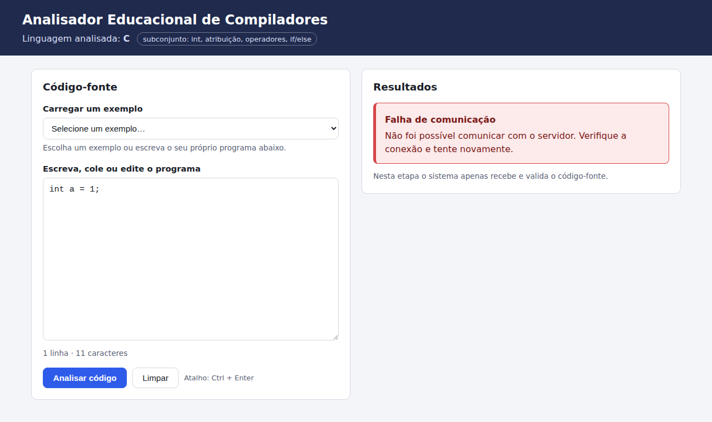

# Analisador Educacional de Compiladores

Software educacional para visualizar as fases de análise **léxica, sintática e semântica** de um programa. O usuário escreve (ou escolhe) um código-fonte e solicita seu processamento por uma interface web.

> **Estado atual (Etapa 2):** interface web, entrada/edição de código, exemplos, comunicação frontend/backend, validações de entrada e testes automatizados. **As análises léxica, sintática e semântica ainda NÃO estão implementadas**: nesta etapa o backend apenas recebe o código, valida a entrada e devolve uma confirmação.

## 1. Objetivo, linguagem e subconjunto

**Linguagem analisada: C.** Subconjunto previsto para as próximas etapas:

| Categoria | Construções |
|---|---|
| Tipos | `int` |
| Declarações | `int x;` e `int x = 5;` |
| Atribuição | `x = expr;` |
| Operadores aritméticos | `+`, `-`, `*`, `/` e parênteses |
| Operadores relacionais | `<`, `>`, `<=`, `>=`, `==`, `!=` |
| Condicionais | `if (...) { ... } else { ... }` |
| Comentários | `// linha` |

Fora do escopo por enquanto: ponteiros, structs, funções, laços, pré-processador e bibliotecas.

## 2. Tecnologias

| Camada | Tecnologia |
|---|---|
| Frontend | HTML, CSS e JavaScript puro, servidos pelo Nginx 1.27 |
| Backend | Python 3.12 + FastAPI (Uvicorn) |
| Orquestração | Docker Compose |
| Testes | pytest (backend), `node:test` + jsdom (interface), Playwright (ponta a ponta), scripts shell (implantação) |

## 3. Estrutura do repositório

```
.
├── backend/
│   ├── app/
│   │   ├── main.py          # rotas e tratamento de erros
│   │   ├── validacao.py     # validações de entrada
│   │   └── exemplos.py      # programas de exemplo
│   ├── tests/               # testes unitários e de endpoints (pytest)
│   ├── requirements.txt / requirements-dev.txt
│   └── Dockerfile
├── frontend/
│   ├── index.html           # estrutura da tela
│   ├── style.css            # aparência (suporta modo claro e escuro)
│   ├── app.js               # validação local, cliente HTTP e interação
│   ├── nginx.conf           # serve a página e repassa /api/ ao backend
│   ├── tests/               # testes de interface e de integração (Node)
│   └── Dockerfile
├── tests/e2e/               # testes de ponta a ponta com navegador (Playwright)
├── scripts/                 # verificação da API, teste de implantação, prints
├── docs/                    # registro de testes e prints da interface
├── config/.env.example
├── docker-compose.yml
└── README.md
```

## 4. Pré-requisitos

- Docker 24+ e Docker Compose v2+ (`docker compose`)
- Git
- Somente para rodar os testes fora do Docker: Python 3.12+, Node.js 20+ (testado com 22)

## 5. Como executar

```bash
git clone https://github.com/felipemoraesm/analisador-educacional
cd analisador-educacional
docker compose up --build
```

Acesse a interface em **http://localhost:8080**. Para rodar em segundo plano use `-d`. Para trocar a porta: `cp config/.env.example .env` e edite `FRONTEND_PORT`.

Para encerrar:

```bash
docker compose down
```

Não há senhas, tokens ou credenciais no repositório; a única variável opcional é `FRONTEND_PORT`.

## 6. Como usar a interface

1. **Escolha um exemplo** no seletor *Carregar um exemplo* (o código aparece na área de entrada e pode ser editado) **ou** escreva/cole o seu próprio programa.
2. Edite o código à vontade. O contador mostra linhas e caracteres.
3. Clique em **Analisar código** (ou use `Ctrl + Enter`).
4. A resposta aparece em **Resultados**:
   - verde: código recebido com sucesso;
   - amarelo: problema na entrada (vazia, só espaços, requisição inválida);
   - vermelho: falha de comunicação com o servidor ou erro inesperado.
5. **Limpar** apaga o código, o exemplo selecionado e o resultado.

O texto digitado nunca é apagado por um erro. O código **não** é presumido válido: entradas com erros de programação são aceitas, pois servirão para demonstrar os analisadores nas próximas etapas.

## 7. Exemplos disponíveis

| # | Exemplo | Construções demonstradas |
|---|---|---|
| 1 | Declaração e inicialização | `int` com e sem valor inicial, atribuição |
| 2 | Operações aritméticas | `+`, `-`, `*`, `/` e parênteses em uma expressão |
| 3 | Estrutura condicional (if) | `if`, operador relacional `>`, bloco com `{ }` |
| 4 | if/else com comentário | `if/else`, operador `==`, comentário `//` |
| 5 | Código com erros intencionais | falta de `;`, expressão incompleta (`x + ;`) e variável não declarada, para as etapas futuras |

Os exemplos são definidos em `backend/app/exemplos.py` e entregues pelo endpoint `GET /api/exemplos`.

## 8. Contrato de comunicação (API)

O navegador chama `/api/...` no Nginx, que repassa ao contêiner `backend:8000`. Assim a mesma configuração funciona dentro do Docker e fora dele, sem depender de endereços de contêiner no navegador.

### `POST /api/analisar`

Requisição: `Content-Type: application/json`

```json
{ "codigo": "int numero = 10;" }
```

Respostas:

| Situação | HTTP | Corpo |
|---|---|---|
| Código recebido | 200 | `{"recebido": true, "mensagem": "Código recebido com sucesso.", "linhas": 1, "caracteres": 16}` |
| Código vazio | 400 | `{"recebido": false, "erro": "codigo_vazio", "mensagem": "Informe um código-fonte antes de solicitar a análise."}` |
| Somente espaços | 400 | `{"recebido": false, "erro": "codigo_somente_espacos", "mensagem": "..."}` |
| Corpo ausente, JSON malformado, campo faltando ou de tipo errado | 400 | `{"recebido": false, "erro": "requisicao_invalida", "mensagem": "..."}` |
| Código acima de 20.000 caracteres | 413 | `{"recebido": false, "erro": "codigo_muito_grande", "mensagem": "..."}` |
| Erro inesperado | 500 | `{"recebido": false, "erro": "erro_interno", "mensagem": "Ocorreu um erro inesperado. Tente novamente em instantes."}` |

Os detalhes técnicos de erros internos ficam apenas no log do servidor; nunca são enviados ao usuário.

### Demais endpoints

| Endpoint | Resposta |
|---|---|
| `GET /api/exemplos` | `{"exemplos": [{"id", "titulo", "descricao", "codigo"}, ...]}` |
| `GET /api/health` | `{"status": "ok"}` (usado pelo healthcheck do Compose) |
| `GET /api/hello` | `{"message": "Hello, World!"}` (mantido da Etapa 1, como teste de regressão) |

### Validações

- **Frontend:** vazio e só espaços são barrados antes do envio, com mensagem ao usuário. Falha de rede, tempo esgotado (10 s) e 502/503/504 são tratados como *falha de comunicação*; qualquer outra resposta inesperada vira *erro inesperado*.
- **Backend:** revalida tudo (vazio, espaços, tamanho, formato da requisição), sem depender do frontend.

## 9. Testes automatizados

| Tipo | Local | Comando |
|---|---|---|
| Unitários e endpoints (backend) | `backend/tests/` | `cd backend && pip install -r requirements-dev.txt && pytest` |
| Interface (jsdom) | `frontend/tests/interface.test.js` | `cd frontend && npm install && npm test` |
| Integração frontend↔backend real | `frontend/tests/integracao.test.js` | `API_URL=http://localhost:8080 npm run test:integracao` |
| Ponta a ponta (navegador) | `tests/e2e/` | `pip install -r tests/e2e/requirements.txt && playwright install chromium && pytest tests/e2e -v` |
| Verificação HTTP da API | `scripts/verificar_api.sh` | `./scripts/verificar_api.sh http://localhost:8080` |
| Implantação (Docker Compose) | `scripts/testar_implantacao.sh` | `./scripts/testar_implantacao.sh` (opcional: `RODAR_E2E=1`) |

Os testes de integração, de ponta a ponta e de implantação exigem a aplicação em execução (`docker compose up --build -d`). Em Windows, use Git Bash ou WSL para os scripts `.sh`.

**Testes de regressão:** os testes de `/api/hello` e `/api/health` (Etapa 1) permanecem em `backend/tests/test_api.py` e em `tests/e2e/`. Todo o conjunto é executado a cada alteração.

### Resultados

O registro detalhado (comandos, quantidades, falhas encontradas e limitações) está em [`docs/testes.md`](docs/testes.md).

| Suíte | Resultado |
|---|---|
| Backend (pytest) | 36 aprovados, 0 reprovados |
| Interface (jsdom) | 37 aprovados, 0 reprovados |
| Integração com backend real | 6 aprovados, 0 reprovados |
| Ponta a ponta (Chromium) | 13 aprovados, 0 reprovados |
| Verificação HTTP da API | 15/15 aprovadas |
| Implantação com Docker Compose | Aprovada: serviços iniciaram, backend saudável e 15/15 verificações da API |

## 10. Prints da interface

| | |
|---|---|
|  |  |
|  |  |

## 11. Validação de instalação limpa

```bash
docker compose down --rmi local -v
docker builder prune -af
cd .. && rm -rf analisador-educacional
git clone git clone https://github.com/felipemoraesm/analisador-educacional
cd analisador-educacional
./scripts/testar_implantacao.sh
```

Registro (preencher):

- Data: 20/10/2026
- Sistema operacional: Windows 11
- Versões de Docker / Compose: 29.8.2
- Resultado: Aprovado. Interface acessível em http://localhost:8080, exemplos carregados e análise respondendo.

## 12. Limitações conhecidas

- **Não há análise léxica, sintática ou semântica.** O backend só recebe e valida o código.
- A interface é um campo de texto simples, sem realce de sintaxe nem numeração de linhas.
- O código é limitado a 20.000 caracteres.
- Os testes de interface usam jsdom (não renderiza CSS) e os de ponta a ponta cobrem apenas Chromium.
- O seletor de exemplos só recarrega um exemplo quando outro é escolhido (escolher o mesmo duas vezes seguidas não o restaura; use outro exemplo e volte).
- Não há banco de dados nem persistência: o código vive apenas na página aberta.

## 13. Próximas etapas

Analisador léxico, analisador sintático e análise semântica para o subconjunto de C, com visualização na interface (o endpoint `POST /api/analisar` é o ponto de entrada onde serão acopladas).
