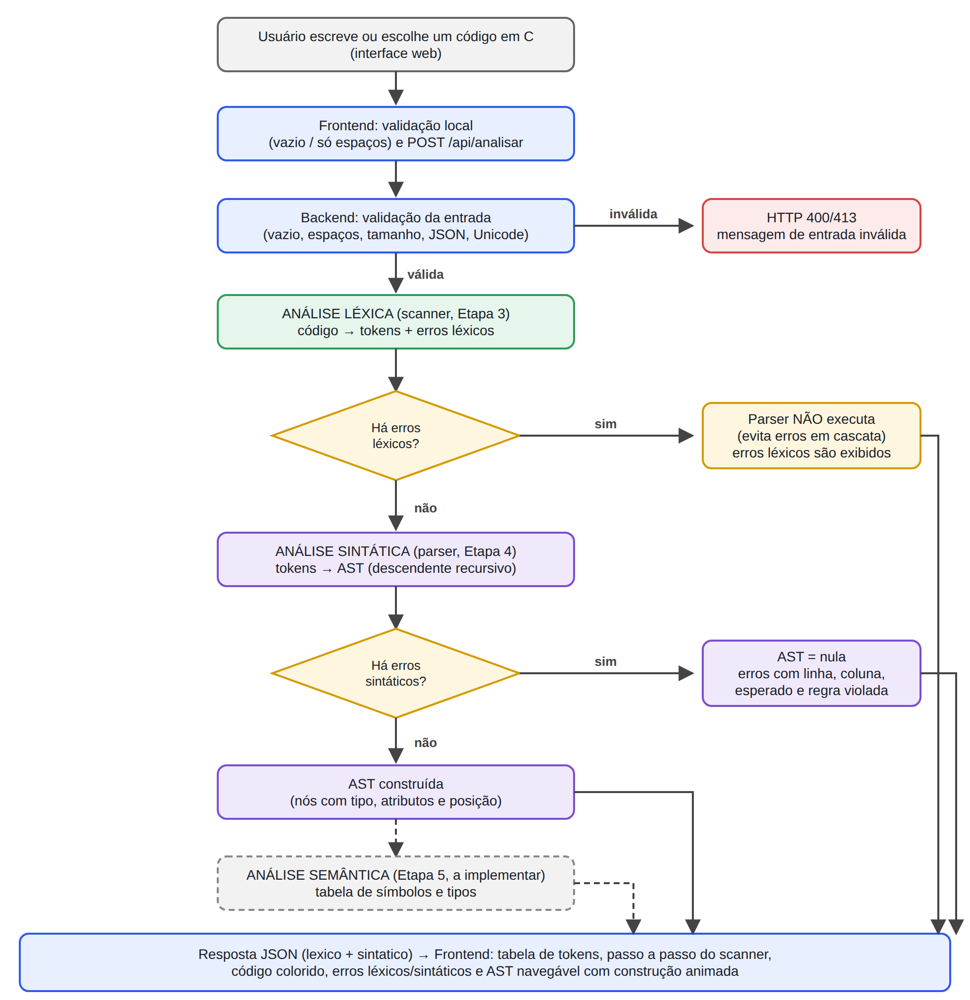
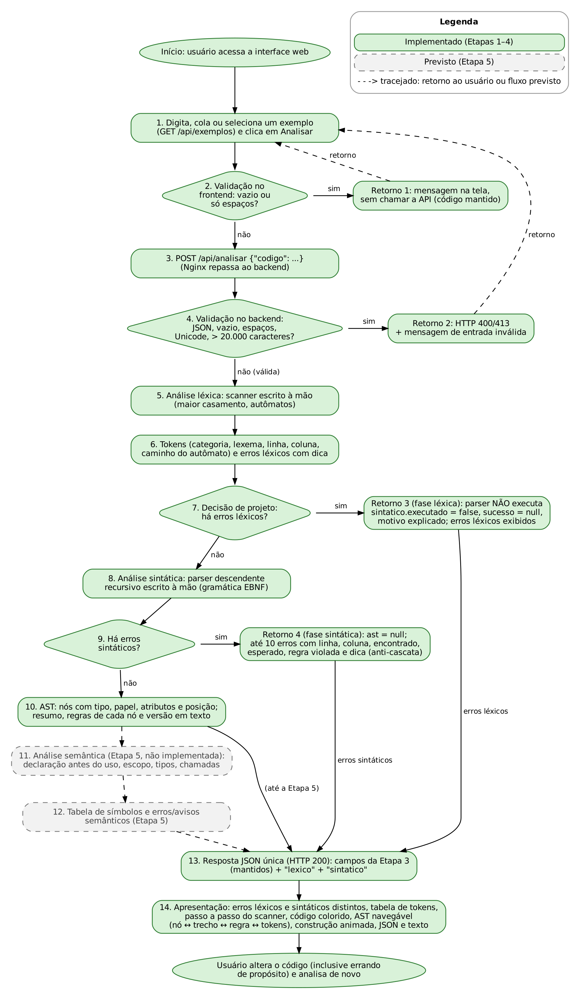
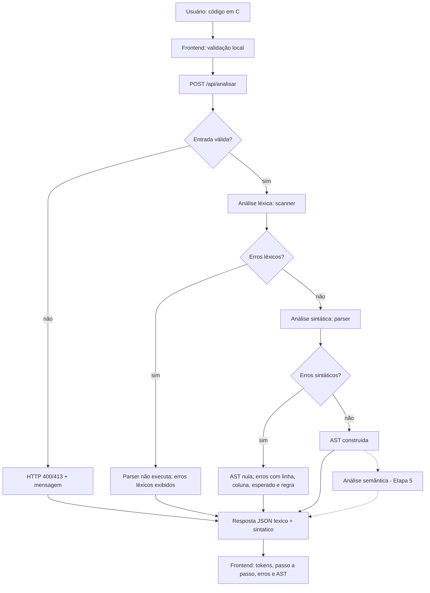

# Fluxograma da análise (entrada → léxica → sintática → semântica → apresentação)



Arquivo vetorial: [`img/fluxograma.svg`](img/fluxograma.svg). Para regenerar: `python scripts/gerar_fluxograma.py`.

## Versão detalhada (usada no artigo)



Mostra os quatro pontos de retorno ao usuário (validação no frontend, validação no backend, erros léxicos e erros sintáticos), a decisão de não executar o parser com erros léxicos e, em cinza tracejado, o que ainda não está implementado (Etapa 5). Fonte: [`diagramas/fluxograma.dot`](diagramas/fluxograma.dot) (PDF e SVG em `img/`). A arquitetura (componentes, contêineres e fluxo de dados) está em [`img/arquitetura.png`](img/arquitetura.png), com fonte em [`diagramas/arquitetura.dot`](diagramas/arquitetura.dot). Para regenerar:

```bash
cd docs/diagramas
dot -Tpng -Gdpi=200 fluxograma.dot -o ../img/fluxograma-detalhado.png
dot -Tpng -Gdpi=200 arquitetura.dot -o ../img/arquitetura.png
```

## Leitura do fluxo

1. **Entrada:** o usuário escreve ou escolhe um código em C. O frontend barra vazio e só espaços e envia `POST /api/analisar`.
2. **Validação (backend):** vazio, só espaços, tamanho, JSON e Unicode. Entrada inválida → HTTP 400/413 com mensagem.
3. **Análise léxica (Etapa 3):** o scanner transforma o código em tokens e erros léxicos.
4. **Decisão:** havendo erro léxico, o parser **não executa** (evita erros em cascata); os erros léxicos são exibidos.
5. **Análise sintática (Etapa 4):** o parser verifica a gramática e constrói a AST, ou devolve erros sintáticos (com a AST nula).
6. **Análise semântica (Etapa 5, a implementar):** receberá a AST para construir a tabela de símbolos e verificar tipos.
7. **Apresentação:** o frontend mostra a tabela de tokens, o passo a passo do scanner, o código colorido, os erros (léxicos e sintáticos, visualmente distintos) e a AST navegável, com construção animada.

## Versão em texto (Mermaid)


